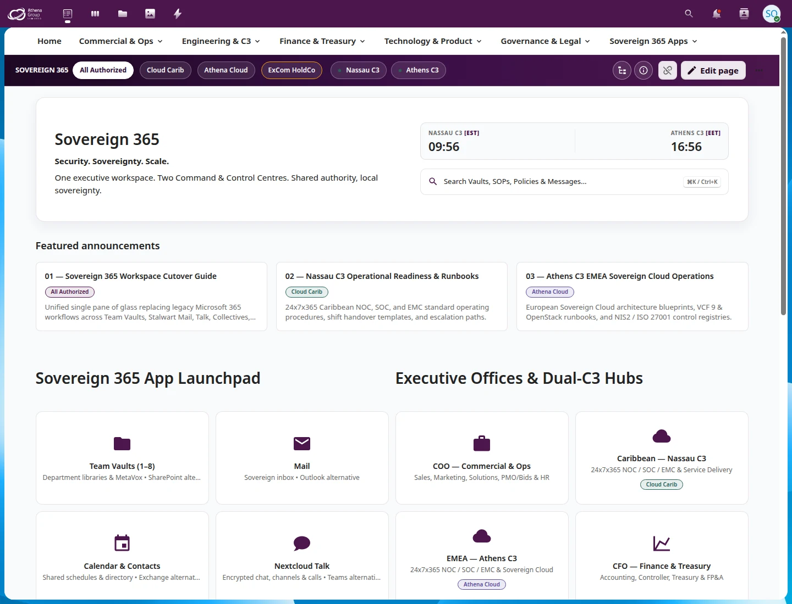
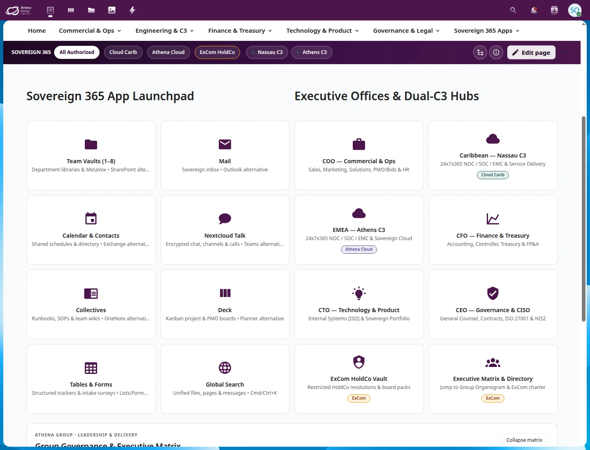
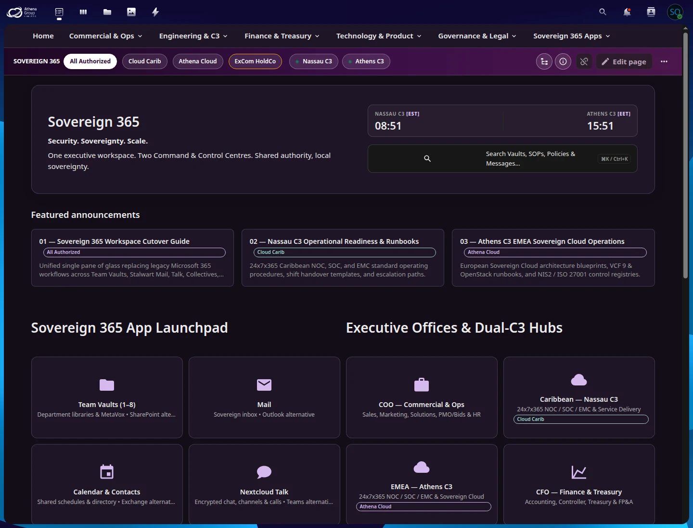
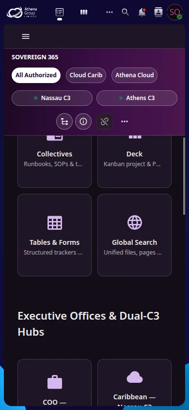
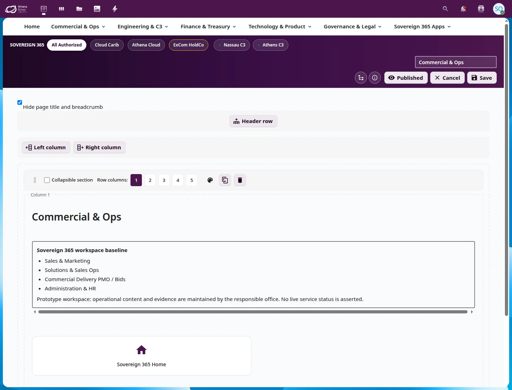
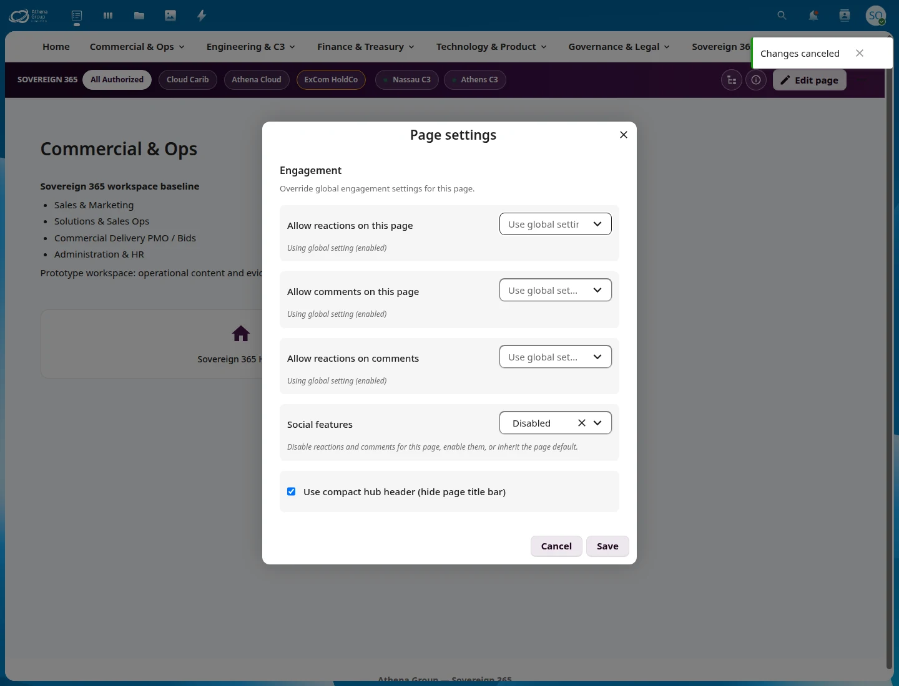

# Sovereign 365 Portal

**The Athena Group workspace on Nextcloud, built on IntraVox.**

One executive workspace, two Command & Control centres, and native Nextcloud
permissions. The Portal brings together the app launchpad, office destinations,
entity-filtered announcements, executive structure, and Unified Search without
replacing Nextcloud's page editor, identity, or access controls.

| Release identity | Confirmed value |
| --- | --- |
| Portal release label | **v1.0** |
| Approved release tag | `version-1.0.0` — reserved for the release after gates pass |
| Nextcloud app ID / version | `intravox` / **3.1.2** — not a Portal marketing version |
| Replit development handoff | [scott-mackenzie/IntraVox-AGL](https://github.com/scott-mackenzie/IntraVox-AGL), branch **`dev`** |
| UX approval | Base UX approved, 17 November 2026; requested final-polish candidate presented for review |
| Release readiness | **Blocked**; see [release notes and evidence](docs/releases/portal-v1.0.md) |

**Development handoff:** the owner has approved pushing the candidate to GitHub
`dev` so downstream developers can run Jenkins, Sonar and CI/CD validation.
This is not a release approval. Known failures and missing evidence travel with
the candidate; they block tagging and promotion, not this development transfer.

> Approval of the UX is not approval to bypass engineering gates. This repository
> does not currently prove a passing full integration gate or a Portal Sonar gate.
> No push, tag creation, package signing, or production deployment is implied by
> this documentation.

## The refined Portal experience



The compact two-tier navigation keeps the entity lens, Nassau/Athens C3
destinations, local-time clocks, search, and page controls together. Announcements
shown here are prototype content, not operational readiness or certification evidence.



Eight app cards and role-aware office destinations: six standard cards, eight for
eligible executive users. Unavailable or unauthorized local apps remain disabled.
A visible card or entity filter never grants access to private content.

<details>
<summary>Native dark theme, mobile, editor, and settings</summary>



Native light, dark, and system themes are retained; the Portal does not force a theme.



The mobile image is a scrolled reader view, not the top of the homepage.



The native editor retains Save, Cancel, layout, and widget controls.



Page settings retain native persistence and per-page controls.
</details>

These are curated, compressed copies of authenticated QA captures of the
requested final-polish candidate, not mockups. The new checks cover compact
entity badges, search alignment, the plum header and footer clearance.
See [screenshot provenance](screenshots/sovereign-portal/README.md).
Raw QA reports, runtime data, and release archives stay outside Git.

## Start here

| Audience | Read |
| --- | --- |
| Sovereign developers receiving a handoff | [Build and downstream playbook](docs/engineering/sovereign-development.md) |
| Reviewers and release owners | [Standards of excellence and gate matrix](docs/engineering/release-quality.md) |
| Release operators | [Portal v1.0 change record, evidence, and release checklist](docs/releases/portal-v1.0.md) |
| Engineers changing Portal behaviour | [Portal code map and design constraints](docs/engineering/portal-code-map.md) |
| Users and administrators | [Documentation index](docs/index.md), [editor](docs/user/editor.md), [authorization](docs/admin/authorization.md) |

## Build from locked source

Use an isolated development checkout. Never run local setup or provisioning
against a production Nextcloud. Read the playbook before executing these commands.

```bash
composer install --prefer-dist --no-interaction
npm ci
node scripts/check-sovereign-docs.cjs
SKIP_INTEGRATION=1 bash scripts/ci-local.sh
npm run build
bash scripts/check-package-contents.test.sh
bash scripts/stage-release.sh
bash scripts/check-package-contents.sh build/intravox-3.1.2.tar.gz
```

**Stop at the first failure.** The commands above are a sequence to run
interactively, not a fail-fast shell script. Integration is deliberately not
claimed by `SKIP_INTEGRATION=1`: [run and record it separately](docs/engineering/sovereign-development.md).
The hero component's missing first size baseline has been recorded without
increasing any previously committed budget. Do not raise budgets, remove locales,
or disable guards to obtain a green badge.

The installable output is **unsigned** `build/intravox-3.1.2.tar.gz`, rooted at
`intravox/`, with production-only Composer dependencies. Signing is a separate,
authorized operation using trusted credentials. Build output, QA evidence,
secrets, and `.runtime/` must not be committed.

## Requirements and compatibility

| Component | Repository contract / evidence |
| --- | --- |
| Nextcloud | App metadata declares **32–35**; the managed local runtime is **32.0.15**. This is not proof of testing on every declared major. |
| PHP | **8.2+**; CI checks the 8.2 floor. Use adequate memory; local QA commands use 512 MB. |
| Group folders | Required for the Portal content and native ACLs. |
| Node / npm | Use a toolchain compatible with the lockfile; the inspected workspace runs Node 24.22.1 / npm 11.19.1. The build agent is not pinned by Jenkins. |
| Composer | Composer 2; runtime and development dependency trees must stay isolated. |
| Companion apps | Availability and permissions are environment-specific. An app shown disabled locally is not evidence that it is absent in production. |

GitHub's frontend guard job uses Node 20 for dependency-free checks; that is
**not** a validated production-build toolchain declaration.

## Upstream → downstream contract

For this project, “upstream” means Replit development and “downstream” means the
Sovereign development team. This is distinct from the original IntraVox project.

- Replit hands changes to **GitHub `dev` only**. Do not push directly to Gitea.
- The owner reports an existing Gitea-to-GitHub mirror that checks each minute.
  Do not reverse it, reconfigure it, or assume a GitHub push updates Gitea.
  Downstream must verify the received commit SHA and tag independently.
- Every code handoff must include matching documentation, change notes, build
  instructions, gate results, limitations, and updated screenshots for changed UX.
- Transfer the exact reviewed source revision and archive checksum. Rebuild or
  repeat affected checks when their inputs change; never reuse stale approval.
- A successful packaging job, accessible login page, or 52 browser checks alone
  is not a passing full release gate.
- Push an authorized development candidate to `dev` before requiring downstream
  CI results. Downstream needs that source to test it; require green release
  gates before tagging or promotion, not before providing the candidate.

See the [end-to-end playbook](docs/engineering/sovereign-development.md) for
source receipt, build, verification, Jenkins/Sonar boundaries, release transfer,
and downstream-owned installation/rollback preparation.

## Attribution and licence

Sovereign 365 Portal is based on [IntraVox](https://github.com/nextcloud/IntraVox)
by **Shalution**. Existing IntraVox capabilities and feature documentation remain
available in the [documentation index](docs/index.md). This fork's screenshots and
release process must not be mistaken for the original project's release status.

Licensed under [AGPL-3.0](LICENSE). Preserve original authorship and licence
notices when distributing source or installable packages.
