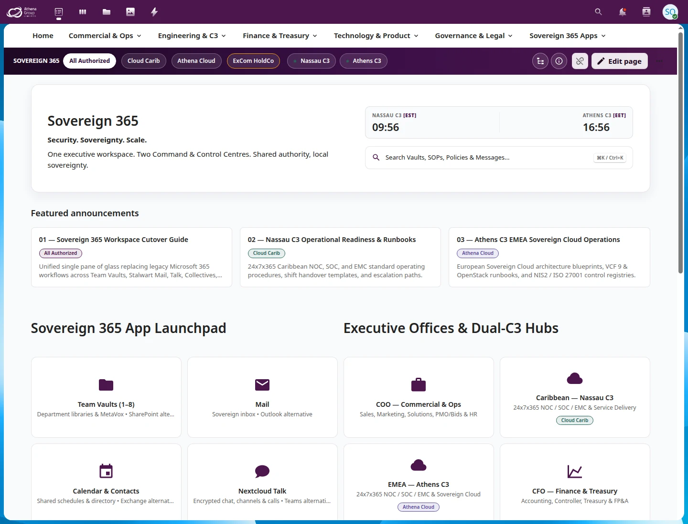

# IntraVox Documentation

Welcome to the IntraVox documentation. IntraVox is a Nextcloud app that turns Nextcloud Files into a SharePoint-like intranet platform — drag-and-drop page editor, widgets, multi-language content, native Nextcloud sharing, versioning, and ACL.

*The approved Sovereign Portal UX. The feature guides below also retain historical IntraVox examples.*

## Sovereign development and release handoff

- [Portal README](../README.md) — current UX, release identity and readiness
- [Build and downstream playbook](engineering/sovereign-development.md) — source receipt through verification and release transfer
- [Standards of excellence](engineering/release-quality.md) — acceptance criteria and actual Jenkins/Sonar enforcement
- [Portal code map](engineering/portal-code-map.md) — implementation entry points and invariants
- [Portal v1.0 release record](releases/portal-v1.0.md) — changes, evidence, blockers and closeout checklist

## Quick Navigation

### For Users

Learn how to create pages, use widgets, and work with content.

- [Overview](user/overview.md) — What IntraVox is and how it fits in your daily workflow
- [Editor Guide](user/editor.md) — Create and edit pages, work with widgets and content blocks
- [Templates](user/templates.md) — Start new pages from templates
- [Versioning](user/versioning.md) — Page version history, preview, and restore
- [Engagement](user/engagement.md) — Reactions and comments
- [Public Sharing](user/public-sharing.md) — Share pages externally with link tokens
- [RSS Feeds](user/rss-feeds.md) — Personal RSS feeds with token authentication
- [Accessibility](user/accessibility.md) — WCAG 2.1 AA compliance and accessibility features

### For Administrators

Installation, configuration, scenarios, and operations.

- [Admin Guide](admin/guide.md) — Day-to-day administration
- [Settings](admin/settings.md) — Admin panel reference
- [Authorization](admin/authorization.md) — Roles, permissions, and GroupFolder ACL
- [Engagement Settings](admin/engagement.md) — Configure reactions and comments
- [Scalability](admin/scalability.md) — Capacity planning and tuning
- [Security](admin/security.md) — Security model and sanitization layers
- [Scenarios](admin/scenarios.md) — Practical recipes (approval workflows, department intranets, more)
- [Showcases](admin/showcases.md) — Example deployments
- [Export & Import](admin/export-import.md) — Move content between instances, including MetaVox integration

### Features

Per-feature documentation for widgets and capabilities.

- [Calendar Widget](features/calendar-widget.md) — Embed calendar events on pages
- [Feed Widget](features/feed-widget.md) — External feeds (Moodle, Jira, SharePoint, ICS, RSS)
- [File Story Widget](features/file-story-widget.md) — Folder-as-document-stream rendering, federation-aware
- [News Widget](features/news-widget.md) — Folder-as-feed news rendering
- [People Widget](features/people-widget.md) — Show people from groups
- [Photo Story Widget](features/photo-story-widget.md) — Folder-as-photo-story with EXIF, maps, timeline, and federation
- [Engagement Architecture](features/engagement-architecture.md) — How reactions and comments work technically
- [Confluence Import](features/confluence-import.md) — Import content from Confluence Cloud, Server, or Data Center

### For Architects & Developers

Technical documentation for integration, evaluation, and contribution.

- [Architecture Overview](architecture/overview.md) — System design and components
- [API Reference](architecture/api-reference.md) — REST API endpoints
- [API Development Guide](architecture/api-development.md) — Build against the IntraVox API
- [Template API Quickstart](architecture/template-api-quickstart.md) — Template API in 5 minutes
- [OpenAPI Tooling](architecture/openapi-tooling.md) — Generating and validating OpenAPI specs
- [SharePoint Comparison](architecture/sharepoint-comparison.md) — Decision-maker mapping between SharePoint Online modern pages and IntraVox, including sovereignty and legislation

#### Architectural Considerations

Design decisions and comparisons that shape the product.

- [Nextcloud-Native Architecture](architecture/considerations/nextcloud-native-architecture.md) — Why "page = folder" inherits enterprise features from Nextcloud
- [Collectives Comparison](architecture/considerations/collectives-comparison.md) — How IntraVox compares to Nextcloud Collectives
- [IntraVox and Nextcloud Teams](architecture/considerations/intravox-and-nextcloud-teams.md) — Where IntraVox sits alongside Teams, and who owns the link to content

## Getting Started

New to IntraVox? Start with the [Getting Started Guide](getting-started.md) for a per-role quickstart.

## Support

- **Issues & Feature Requests**: [GitHub Issues](https://github.com/nextcloud/IntraVox/issues)
- **Source Code**: [GitHub Repository](https://github.com/nextcloud/IntraVox)

## License

IntraVox is licensed under the [AGPL-3.0 License](https://www.gnu.org/licenses/agpl-3.0.html).
